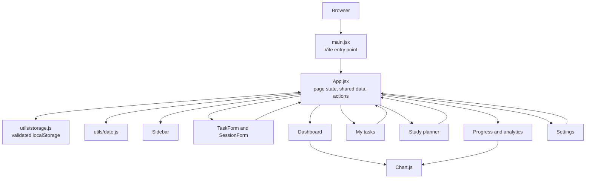

# Application architecture

The React application owns task, study-session, and preference state. `App.jsx` passes values and callbacks to the active page and forms. A storage utility reads/writes JSON in browser localStorage, and the dashboard and analytics derive their visualizations from the same state. There is no backend or remote API.
